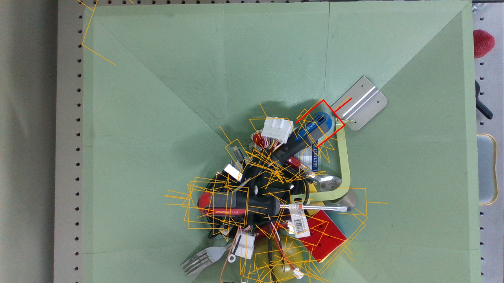

# exp_foundgrasp

FoundGrasp 파지 검출을 **실제 로봇(xArm7 + RealSense D435 + KORAS 그리퍼)** 에서
실행하는 파지-이적재 실험 플랫폼. 물체 박스를 스캔해 그립을 검출·선정하고,
집어서 릴리즈 박스로 옮기는 루프를 반복한다. 검출 백엔드가 교체 가능한 구조라
다른 파지 모델(비교군)을 같은 하드웨어·절차로 비교 실험할 수 있다.

<p align="center"></p>

```
스캔 자세 → 캡처 → 검출(FoundGrasp) → ROI 필터 → 선정(IK·수직성·카메라 상향)
→ pre-grasp(그리퍼 개방 병행) → 저속 접근 → 파지 → 상승 → 상방 경유 → 릴리즈 → 반복
```

## 구성

```
exp_foundgrasp/
├── run.py                  실행 진입점 (python run.py [--auto|--dry-run])
├── configs/
│   ├── default.yaml        모든 설정 (로봇·카메라·그리퍼·선정·장면·옵션)
│   └── calib/              hand_eye.yaml, intrinsics.yaml, box_floor.npz, payload_baseline.npz
├── efg/                    핵심 패키지
│   ├── detectors/          파지 검출 백엔드 — 비교군 확장 지점 (base.py 계약)
│   ├── camera / robot / gripper / motion   하드웨어
│   ├── transforms / selection / roi / floor / payload / viz   파이프라인
│   └── demo.py             파지-이적재 루프
├── scripts/                사전 준비·점검 도구 (아래 "빠른 시작")
├── tests/                  단위 테스트 (하드웨어 불필요) + tests/data/sample_frame.npz
├── third_party/
│   ├── FoundGrasp/         원본 사본 — 수정하지 않음
│   └── koras-gripper-wrapper/  그리퍼 드라이버 원본 사본 — 수정하지 않음
└── outputs/                실행 산출물 (git 미추적)
```

## 요구 사항

| 항목 | 내용 |
|---|---|
| 로봇 | UFACTORY xArm7 (SDK 1.18.4, 이더넷). Studio에 **TCP offset = 그리퍼 끝**, **TCP payload = 그리퍼 질량** 설정 |
| 카메라 | Intel RealSense D435, 손목 장착(eye-in-hand). hand-eye 캘리브레이션 결과 필요 |
| 그리퍼 | KORAS 2FPA-I-03-100 (Modbus RTU, USB 시리얼). 계정이 `dialout` 그룹이어야 함 |
| GPU | CUDA GPU (FoundGrasp 추론) |
| 환경 | conda `foundgrasp` (Python 3.10, torch 2.9 cu128, numpy<2) |

## 설치

```bash
conda create -n foundgrasp python=3.10 -y && conda activate foundgrasp
pip install torch==2.9.0 torchvision==0.24.0 --index-url https://download.pytorch.org/whl/cu128
pip install "numpy<2" scipy opencv-contrib-python pillow tqdm matplotlib albumentations h5py \
            transformers omegaconf huggingface_hub open3d pyyaml pytest
pip install git+https://github.com/seungback/graspnetAPI.git
pip install pyrealsense2 xarm-python-sdk pymodbus pyserial rerun-sdk==0.33.1 trimesh
```

- FoundGrasp 체크포인트는 git에 없다. `third_party/FoundGrasp/logs/final/foundgrasp_base/checkpoints/final_model.pth`
  에 배치 (경로는 `detector.foundgrasp.checkpoint`). 백본 가중치는 첫 실행 시 HuggingFace 캐시로
  받는다 (오프라인 강제: `HF_HUB_OFFLINE=1`).
- `opencv-python`과 `opencv-contrib-python`을 함께 설치하지 말 것.

설치 확인 (카메라·로봇 불필요):

```bash
python -m pytest tests/ -q
python scripts/run_inference.py --npz tests/data/sample_frame.npz --vis outputs/grasps.jpg
```

## 빠른 시작

하드웨어 배치가 바뀌었을 때 순서대로 한 번씩. 각 스크립트는 결과를 `configs/default.yaml`에 기록한다.

```bash
conda activate foundgrasp && cd exp_foundgrasp

python scripts/set_roi.py            # 1) 스캔 영역: 카메라 이미지에서 물체 박스 내부 드래그
python scripts/align_scan_pose.py    # 2) 스캔 자세: 카메라를 박스 중심 수직 상방으로 (자동)
python scripts/teach_scan_pose.py    #    또는 수동 — 라이브 화면 보며 조정 후 s
python scripts/set_roi.py            # 3) 시점이 바뀌었으므로 스캔 영역 재지정
python scripts/teach_drop.py         # 4) 릴리즈 자세: 릴리즈 박스 상방으로 옮기고 Enter

python run.py --dry-run              # 5) 로봇 없이 스캔·검출·선정 확인
python run.py                        # 6) 실행 (pre-grasp 이동 중 폭 조절 후 자동 접근)
python run.py --auto                 #    무인 연속 실행
```

실행 중: 라이브 창에서 `q` = 정지 요청(홈 복귀 후 종료). ROI에 후보가 없거나 연속 실패
시 터미널에서 대기(Enter 재개 / q 종료). 이동 실패로 중단되면 로봇은 그 자리에 정지한다
(자동 복귀가 2차 충돌을 만들 수 있음 — xArm Studio로 확인 후 복귀).

## Rerun 뷰어

기본 설정(`rerun.viewer: native`)에서는 실행 시 별도의 데스크톱 창이 자동으로 열린다.
`.rrd` 기록 저장은 유지하며, 데이터 연결은 웹 서버와 겹치지 않는 9877 포트를 사용한다.

브라우저 방식이 필요하면 `python run.py --set rerun.viewer=web`으로 실행한다.
웹 모드에서는 아래 **동일한 주소**로 접속한다. 전체 링크를 북마크하면 된다.

[Rerun 열기](http://127.0.0.1:9090/?url=rerun%2Bhttp%3A%2F%2F127.0.0.1%3A9876%2Fproxy)

웹 포트는 `rerun.web_port: 9090`, 데이터 포트는 `rerun.grpc_port: 9876`이다.
`python run.py`가 서버를 시작하고, 다음 실행에서는 재사용한다. 실행이 끝나도 서버는
남아 있으며 기록은 실행별로 분리된다. `/` 주소만 열면 데이터에 자동 연결되지 않을 수
있으므로 위 전체 URL을 사용한다. 서버 시작 실패 로그는 `outputs/rerun_server.log`에 남는다.

로봇 외형은 제조사 xArm7 모델을 GLB로 변환해 부품별 흰 외장·회색 금속 재질을 보존한다.
원본에는 이미지 텍스처가 없다. 출처·라이선스는 `third_party/xarm7_visual/`에 있고,
재생성 도구는 `scripts/build_xarm_visuals.py`이다. 기구학은 기존 MJCF를 사용한다.

로봇 자세와 스캔·파지 데이터는 공통 `elapsed` 시간축으로 기록하며, 기본 뷰는
최신 시점을 따라간다. 관절각은 SDK 캐시에서 10Hz로 읽으므로 이동 중에도 갱신된다.
기존 뷰어 설정이 남아 있으면 시간축을 `elapsed`로 선택하고 최신 시점 따라가기를 켠다.
`Scan snapshot (not live)`는 홈 스캔 당시의 이미지·점군이며 로봇 이동 중에도 고정된다.
후보는 점수 순으로 12mm 이내 중복 지점을 덜어내 최대 25개만 표시한다
(`rerun.max_candidates`, 검출·제어 후보 수와 무관). `Grasp detail` 탭은 로봇을
제외한 파지 장면을 확대해 볼 수 있다.
Matplotlib `RdYlGn`으로 표시 후보의 점수 최저→최고를 빨강→노랑→초록으로 매핑하고 범례에 범위를 적는다.
색은 현재 표시 집합 내 상대 점수이며 성공 확률이 아니다. 같은 규칙이 2D/3D와 저장 이미지에 적용된다.
1위는 화면 크기 기준 굵은 선과 별도 라벨로 표시하고, 2D에서는 흰색 외곽선과 최상위
표시 순서를 적용한다. 실행 대상으로 선정된 그립은 청록색이다. 성공·실패 색/지표는 표시하지 않는다.
상태 패널에는 홈 복귀·스캔·접근·닫기·상승·이송·놓기 등 동작 단계가 표시된다.
그리퍼 메쉬는 모서리를 다듬은 본체, 금속 핑거, 고무 팁의 근사 형상이며 제조사 CAD가 아니다.
개방 폭은 기존 제어 루프의 마지막 상태 판독값과 경과 시간을 표시한다(추가 Modbus 읽기 없음).
dry-run에서는 측정값이 없으므로 목표 폭 미리보기로 명시한다.

## 카메라 프로세스와 추론 초기화

`run.py`는 카메라 SDK의 생성·캡처·정렬·depth 필터·종료를 별도 프로세스에서 수행한다.
메인 프로세스는 공유 메모리의 최신 RGBD 한 장만 복사한다. 캡처 시각 기준 2초 이상
오래된 프레임이나 카메라 프로세스 오류가 있으면 다음 접근·자동 홈 복귀를 차단한다.
SDK의 암묵적인 재연결 대신 프레임 수신 기한을 적용하며, 종료가 멈추면 카메라
프로세스만 종료한다. USB 장치 자체의 단절을 자동 복구하거나 동작을 재개하지는 않는다.

최초 CUDA 초기화 비용은 `detector.warmup_runs: 1`로 로봇 연결 전에 처리한다.
워밍업 결과는 파지 선정에 사용하지 않는다. 로그의 `검출` 시간에는 refiner가 포함되며,
공유 충돌검사·선정·로봇 이동 시간은 포함되지 않는다.

모델과 로봇 없이 카메라 연결만 확인하려면:

```bash
python scripts/check_camera.py --seconds 60
```

Linux UVC 경로의 연결 오류를 우회해 확인하려면 별도 RSUSB 설치를 사용할 수 있다.
SDK 2.58.2를 `~/.cache/foundgrasp-rsusb/install`에 빌드하며, 기존 Conda 패키지는
덮어쓰지 않는다. 빌드에는 C/C++ 컴파일러, make, git, curl, libusb 런타임이 필요하다.

```bash
conda activate foundgrasp
bash scripts/build_rsusb.sh
bash scripts/with_rsusb.sh python scripts/check_camera.py --seconds 60
# 카메라 확인 후 추론까지 확인 (로봇 연결/이동 없음)
bash scripts/with_rsusb.sh python run.py --dry-run
```

실제 로봇 실행에도 같은 접두사(`bash scripts/with_rsusb.sh`)를 붙인다.
접두사 없이 실행하면 기존 SDK를 사용한다. RSUSB는 커널 `uvcvideo` 대신 libusb를
사용하지만, 케이블·전원·USB 컨트롤러 등에서 발생하는 단절까지 해결을 보장하지는 않는다.
RealSense Viewer와 캡처 프로그램은 동시에 실행하지 않는다.

## 실행 옵션

플래그는 셋뿐이다. 나머지 동작은 전부 설정 파일에서 정한다.

| | |
|---|---|
| `--auto` | 기본 동작과 동일 (호환 옵션) |
| `--confirm` | pre-grasp에서 정지하고 접근 확인 (블렌딩 비활성) |
| `--dry-run` | 스캔·검출·선정만, 로봇/그리퍼 미사용 |
| `--config PATH` | 다른 설정 파일 사용 |
| `--set KEY=VALUE` | 설정 항목 일시 변경 (반복 가능) |

```bash
python run.py --set live.enabled=false                   # 라이브 창 끄기
python run.py --set floor_limit.enabled=true             # 하강 제한 켜기
python run.py --set output.save_cycles=true              # 사이클 이미지 기록
python run.py --set selection.approach_max_tilt_deg=20 --auto
```

실험별 설정은 `base:`로 기본값을 상속해 바꿀 항목만 적는다:

```yaml
# configs/exp_tilt20.yaml
base: default.yaml
selection: {approach_max_tilt_deg: 20}
output: {dir: outputs/tilt20, save_cycles: true}
```

## 설정 요약 (`configs/default.yaml`)

| 그룹 | 주요 항목 |
|---|---|
| `detector` | `name`(백엔드), `device`, `foundgrasp.{config, checkpoint, top_k, collision_detection}` |
| `calib` | `hand_eye`(T_flange_cam), `intrinsics`(캘리브레이션 K — hand-eye와 동일해야 함) |
| `robot` | `ip`, `home_joints_deg`(스캔 자세), 이동·접근 속도/가속도 |
| `camera` | 해상도·fps, `postprocess`(RealSense depth 필터) |
| `gripper` | `port`(by-id 고정 경로), 힘/속도, `pre_open_margin_mm`, `grip_success_min_pct` |
| `selection` | 작업공간, `approach_max_tilt_deg`, 삽입 깊이(`approach_extra_m`), `j7_limit_deg`, `camera_up` |
| `scan_roi_px`, `drop` | 스캔 영역, 릴리즈 자세·이송 속도·경유 높이 |
| `grip_check`, `payload_check`, `floor_limit` | 아래 "선택 기능" |
| `live`, `output` | 라이브 창, 산출물 폴더·사이클 이미지 저장 |

## 선택 기능 (기본 꺼짐)

**하강 제한 `floor_limit`** — 빈 박스를 한 번 스캔해 높이맵을 만들고, 선정 그립의 TCP·핑거
끝이 `표면 + clearance` 아래로 가지 않게 삽입량을 줄인다 (부족하면 후보 탈락·재선정).
박스 CAD 없이 바닥·벽(경사 포함) 충돌을 막는다.
```bash
python scripts/scan_box_floor.py        # 빈 박스 스캔 → configs/calib/box_floor.npz
python run.py --set floor_limit.enabled=true
```

**페이로드 파지 판정 `payload_check`** — 릴리즈 자세에서 관절 토크를 빈 손 기준값과 비교해
"손에 질량이 있는가"로 성공을 판정한다. 플렉스 팁처럼 finger 간격으로 판정할 수 없는
그리퍼용. 릴리즈 자세를 다시 티칭하면 재측정.
```bash
python scripts/calib_payload.py         # 빈 손 + 샘플 물체 → configs/calib/payload_baseline.npz
python run.py --set payload_check.enabled=true
```

**파지 성공 판정 `grip_check`** — **기본 꺼짐**: 판정값(finger %, 페이로드 Δ)을 출력만 하고 항상 이송을
진행한다 (플렉스 팁은 finger 간격 판정이 부정확하므로). `enabled: true`로 켜면 finger 간격
(`gripper.grip_success_min_pct`) + 켜져 있는 경우 페이로드 판정으로 실패를 걸러 재시도한다.
꺼진 상태에선 실패 재시도가 동작하지 않으므로 `--auto`와 함께 쓸 때 주의.

## 비교군(다른 파지 모델) 추가

검출 백엔드 하나만 구현하면 ROI·좌표 변환·선정·모션·판정은 그대로 쓰인다.

1. 원본 코드를 `third_party/<Name>/`에 두고(무수정), `efg/detectors/<name>.py`에 구현:
   ```python
   from ..paths import THIRD_PARTY, add_vendor_paths
   from .base import GraspDetector

   class MyDetector(GraspDetector):
       name = "mymethod"
       def __init__(self, cfg, device="cuda"):
           super().__init__(cfg, device)
           add_vendor_paths(THIRD_PARTY / "MyMethod")
           ...  # cfg = 설정의 detector.mymethod 블록
       def detect(self, rgb, depth_m, K, top_k=None):
           ...  # → graspnetAPI GraspGroup (카메라 좌표계, score 내림차순)
   ```
   계약: 입력 `rgb (H,W,3) uint8`, `depth_m (H,W) float32 m (무효=0)`, `K (3,3)`; 출력은
   graspnetAPI 규약(회전행렬 1열=접근, 2열=개폐, width·depth 미터).
2. `efg/detectors/__init__.py`의 `REGISTRY`에 `"mymethod": ("efg.detectors.mymethod", "MyDetector")` 추가.
3. 설정에 `detector.mymethod: {...}` 블록을 두고 `detector.name: mymethod` (또는 `--set detector.name=mymethod`).

오프라인 검증: `python scripts/run_inference.py --npz tests/data/sample_frame.npz --set detector.name=mymethod --vis outputs/my.jpg`

## 운용 규칙 · 안전

- **그리퍼**: 전원 투입 후 본체 버튼(I)으로 초기화. 소프트웨어 Modbus 초기화(101)는 close 방향
  학습을 손상시키므로 금지 (`initialize_on_connect: false` 유지). 연결 시 개방·close 방향을
  실측 점검해 이상 상태로 로봇이 움직이는 것을 차단한다.
- **로봇**: 확인 프롬프트가 필요하면 `--confirm`으로 실행하고 비상정지에 손을 올린 채 진행.
  TCP offset·payload가 실제 그리퍼와 다르면 삽입 깊이·충돌 감지(C31)가 어긋난다.
- **캘리브레이션**: 카메라 마운트를 다시 조이거나 위치가 바뀌면 hand-eye 재캘리브레이션
  (별도 도구 `r_foundgrasp/02.dev/hand_eye_calib`) 후 `configs/calib/hand_eye.yaml`·`intrinsics.yaml` 교체.
- **팁·툴 교체 시**: TCP offset/payload, `gripper.stroke_mm`, `selection.max_grasp_width_m`,
  파지 판정 방식(`grip_success_min_pct` 또는 `payload_check`) 재검토.

## 점검 도구

```bash
python scripts/camera_preview.py                 # D435 라이브 (s: 프레임 npz 저장)
python scripts/gripper_test.py [--status]        # 그리퍼 연결·개폐 / 상태만
python scripts/gripper_direction_check.py        # 펌웨어 방향 반전 여부 실측 판정
python scripts/run_inference.py --live --vis outputs/live.jpg   # 검출만
```

## 테스트

```bash
python -m pytest tests/ -q     # 38건: 변환·선정 기하, 그리퍼 시퀀스(모의), 페이로드 판정,
                               #       하강 제한, 설정 로드/상속/--set, 검출기 레지스트리
```

## 트러블슈팅

| 증상 | 조치 |
|---|---|
| `그리퍼 포트 열기 실패` | `ls -l /dev/serial/by-id/`로 경로 확인 → `gripper.port`. 권한: `sudo usermod -aG dialout $USER` 후 재로그인 |
| `grip_close 방향 점검 실패 (반전/무동작)` | 펌웨어 방향 손상 — 24V 재투입 + 핑거 자유 상태에서 버튼(I) 초기화. 임시 우회 `gripper.grip_mode: "position"` |
| `후보 N개 → ROI 내 0개` 반복 | ROI가 박스 안쪽인지, 스캔 자세 변경 후 `set_roi.py`를 다시 했는지 확인 |
| 선정 후보 전부 `작업공간 밖` | `--dry-run`은 로봇 자세가 없어 정상. 실행 시엔 `selection.workspace_*_m`·hand-eye 확인 |
| `릴리즈 자세가 기준값 측정 자세와 다름` | `teach_drop.py` 후 `calib_payload.py` 재실행 |
| C31 충돌 오감지 정지 | Studio의 TCP payload 확인. 이송 가속도는 `drop.joint_acc_deg_s2` (기본 설정 180 deg/s²) |
| 백본 다운로드 시도 | 오프라인이면 `HF_HUB_OFFLINE=1` |

## 설계 근거 (요약)

- **ROI = depth 마스킹 + 투영 필터**: 전체 프레임 추론은 top-k가 ROI 밖 물체 더미에 몰려 ROI 내
  0개가 되는 문제가 실측됨. ROI 밖 depth를 0으로 두면 인공 표면 없이 후보가 ROI 안에서만 생긴다.
- **선정**: score 순으로 첫 실행 가능 후보 채택. 같은 후보의 파지·상승 180° 대칭
  조합 중 관절 이동 비용이 작은 경로를 선택. tilt 상한 25°(29°에서 self-collision 실측).
- **모션**: 그리퍼 폭 조절은 pre-grasp 이동과 병행. 파지 후 pre-grasp까지 복귀해
  홈 TCP 방향 또는 그 180° 대칭 방향으로 상승하고, 정지 확인 후 릴리즈 자세로 조인트 이송.
  제어된 종료만 홈 복귀.
- **재시도**: 실패 시 홈 복귀 후 전체 재스캔(물체가 밀렸을 수 있음), 직전 실패 지점 반경 제외.

접근은 pre-grasp 이동을 먼저 비차단 전송하고, 이동 중 그리퍼 폭을 조절합니다.
폭 도착을 확인한 뒤에만 grasp 명령을 전송합니다. 폭 조절이 늦으면 pre-grasp에서
대기할 수 있으며, 조절 중에도 카메라·중단 요청을 확인합니다.
`robot.pregrasp_blend_radius_mm`(기본 설정 10 mm)로 pre-grasp 부근을 둥글게 통과하고,
두 구간 모두 `robot.approach_acc_mm_s2`를 적용합니다. 최종 파지점은 정지 후
위치 2 mm·자세 1° 이내 도착을 확인해야 그리퍼를 닫습니다. 카메라 오류나
로봇 오류, 접근 시간 초과 시 정지하고 대기 명령을 취소합니다. 파지·릴리즈·스캔
정지는 유지됩니다. 상승→조인트 이송의 혼합 블렌딩은 C24 재발로 제거했습니다.
높은 경유점에서 정지·빈 큐·TCP 위치 2 mm/자세 1° 이내 도착을
`drop.transfer_confirm_s`(기본 설정 0.10초) 동안 확인한 뒤에만 조인트 이송 명령을 보냅니다.
파지 후에는 파지 자세로 pre-grasp까지 역방향 복귀한 뒤, XY를 유지하며
상승하는 동안 홈에서 실측한 TCP 방향 또는 그 툴 z축 180° 대칭 방향으로 손목을 폅니다.
선정된 대칭 방향은 실행까지 유지합니다. pre-grasp 전환은
`robot.retreat_blend_radius_mm`(기본 설정 10 mm) 반경으로 연결합니다.
두 블렌딩 반경은 인접 구간 길이의 1/4 이하로 제한하며, 반경을 키우면 경유점
주변에서 경로를 더 둥글게 통과합니다. 높은 경유점은 `max(선정 상승 높이,
drop.via_height_m, pre-grasp 높이 + 5 cm)`에 `drop.transfer_clearance_margin_mm`
(기본 10 mm)만큼 여유를 더합니다. 높은 경유점의 IK·J7도 파지 후보 선정 시
검사하며, 실행 전 IK·J7을 다시 확인합니다. 릴리즈에서는
정지·큐 비움·관절 목표 오차 0.5° 이하를 확인한 뒤 개방합니다. 명령 거부 시
다른 경로로 재시도하지 않고 큐를 정지합니다.

IK 검사를 사용하는 실제 실행에서는 파지 두 방향 × 상승 두 방향의 최대 네 조합을
비교합니다. 현재 실측 관절 → pre-grasp → grasp → pre-grasp → 상승 → 티칭된
릴리즈 관절 경로에서, 각 구간의 최대 관절 변화량을 합산하고 동률이면 전체 관절
이동량 합계를 비교합니다. 각도 차를 ±180°로 감아 케이블 회전을 축소 계산하지 않습니다.
카메라 하향 한도와 J7 범위를 통과한 조합만 비교하고, 비용이 같으면 카메라 상향을
우선합니다. 제약 때문에 두 대칭 중 하나만 가능하면 회전량이 줄지 않을 수 있습니다.
이는 종점 IK 기반 비용 추정이며 전체 경로 충돌 검사나 실제 최단시간 보장은 아닙니다.
드라이런·후보 IK 검사 비활성 시에는 관절 비용 최적화를 하지 않고 기존 홈 상승 방향을 씁니다.
사이클 상세에 선택한 상승 방향과 TCP 회전각을 표시하며, `--verbose`에서는
파지·상승 sign, 가능한 조합 수와 관절 이동 비용도 볼 수 있습니다.

파지점과 릴리즈 관절 목표의 연속 도착 확인 시간은 각각
`robot.approach_confirm_s`, `drop.arrival_confirm_s`(기본 설정 모두 0.05초)입니다.
세 확인 시간은 0.04~1초 범위이며 조건이 깨지면 연속 확인을 처음부터 다시 합니다.
설정이 없는 기존 파일은 0.2초를 유지합니다. 이 시간은 실제 이동이 끝난 뒤의
추가 확인 시간이며, 정지·빈 큐·목표 도착 조건을 생략하지 않습니다.
사이클 상세 로그에 파지점·상승·릴리즈 도착 확인 시간을 각 구간에 포함된 값으로 표시합니다.
기본 속도는 이동 600, 접근 200, 복귀 400, 자세 전환 350 mm/s, 홈·이송 120°/s입니다.
상승 시 회전량/이동거리 기반 속도 산정 기준은 150°/s이며,
복귀·자세 전환 가속도는 700 mm/s²입니다.

C24(속도 한계 초과) 대응으로 파지 후 복귀와 손목 자세 전환의 속도를 분리했습니다.
`robot.retreat_speed_mm_s`는 pre-grasp 복귀 상한,
`robot.reorient_speed_mm_s`는 자세 전환 상한입니다. 두 값 모두
`robot.lift_speed_mm_s` 이하로 제한됩니다.
자세 전환은 추가로 `이동거리(mm) × reorient_angular_speed_deg_s / 회전각(deg)`로
속도를 제한합니다. 이는 TCP 경로 평균 회전 시간 기반의 보수적 산정이며 관절별
최대 속도나 특이점 회피를 보장하지 않습니다. 전환 가속도는
`robot.reorient_acc_mm_s2`, 조인트 이송 속도는 `drop.joint_speed_deg_s`입니다.
오류 발생 시 실제 TCP·관절각·대기 명령 수를 출력하고 큐를 정지하며 자동 재시도하지 않습니다.

정상 반복 운전에서는 최초 활성화 이후 모드·모터·오류·정지 상태·빈 큐를 확인하고,
매번 활성화 명령과 0.5초 대기를 반복하지 않습니다. 실행 중 정지/오류/모드 변경이
발견되면 자동 재활성화 없이 중단합니다. 조인트 가속도는 홈 복귀의
`robot.home_joint_acc_deg_s2`, 이송의 `drop.joint_acc_deg_s2`로 지정합니다.
기본 설정은 180°/s²입니다. 키를 생략하면 기존 50°/s²를
사용합니다. 짧은 이동에서는 최고 속도보다 가속도가
이동 시간을 제한할 수 있습니다.

매 사이클 홈 복귀 시작부터 릴리즈 조건 충족까지의 전체 시간과 구간별 시간을 출력합니다.
접근 시간은 병행하는 폭 조절을 포함하고, 추론·선정·시각화 시간은 결과 기록까지
포함합니다. 재추론은 같은 사이클에 누적되며, `--confirm`에서는 사용자 입력 대기도
포함됩니다. 이 값은 호스트에서 측정한 구간 경과 시간으로, 컨트롤러 내부 궤적 시간과
동일하지 않습니다.
접근 상세에는 최종 grasp 명령 전송 전·후의 시간을 나눠 표시합니다. 명령 전 시간에는
pre-grasp 이동과 병행하는 폭 조절이 포함됩니다. 명령 후 시간에는 남은 pre-grasp 이동,
최종 접근과 도착 확인이 포함될 수 있습니다. 폭 조절 시간은 별도 참고값으로 표시하며
전체 시간에 다시 더하지 않습니다.

기본 터미널 출력은 사이클별 검출·후보·선정·실행 결과와 **택타임**으로 묶습니다.
평균·최단·최장 택타임은 릴리즈까지 완료한 사이클만 집계하며, 파지 성공률을 뜻하지
않습니다. 후보 없음·중단·dry-run은 `소요시간`으로 표시하고 평균에서 제외합니다.
장면 보충 입력 대기는 해당 사이클 측정을 끝낸 뒤 시작합니다.
refiner 통계·폭 분포·자세 선택·모션 속도 등 상세 진단은 `python run.py --verbose`
또는 `--set output.verbose=true`로 표시합니다. 경고·오류는 기본 모드에서도 표시합니다.
모델 초기화의 긴 stdout은 `outputs/<실행이름>/model_init.log`에 저장합니다
(`output.save_cycles`와 무관). stderr 경고와 로딩 진행률은 그대로 표시합니다.

출력 예시 (시간은 설명용):

```text
  CYCLE 003  |  홈 → 파지 → 릴리즈
  검출      114 ms  |  추론 113 ms (refiner 64 ms 포함) · 후처리 1 ms
  후보      50 → score 50 → 폭 5 → ROI 5  |  폭 한계 95 mm
  선정      #1/5 · score 0.265133 · 폭 60 → 개방 60 mm · 기울기 18°
  결과      이송 완료
  택타임    6.42s  |  평균 6.51s · 최단 6.42s · 최장 6.60s · 완료 3회
  구간      홈 복귀 1.20s · 캡처·안정화 0.31s · 추론·선정·시각화 0.18s
            모션 준비 0.02s · 접근(폭 조절 병행) 1.30s · 파지 닫힘 0.40s
            복귀·상승 1.50s · 조인트 이송 1.20s · 개방 0.31s
```

pre-grasp 폭 조절 최소 대기는 `gripper.pre_open_min_wait_s`(기본 0.15초, 기존 1초)이며,
목표 폭 도착과 연속 3회 정지 확인을 통과해야 최종 접근 명령을 보냅니다.
그리퍼 닫힘 최소 대기는 `gripper.close_min_wait_s`(기본 설정 0.15초)입니다.
`gripper.speed_pct`는 이미 API 상한인 100%이며, 최소 대기를 줄이는 것은
모터 회전 속도 증가와 다릅니다. 손가락 이동·정착이 더 오래 걸리면 계속 기다립니다.
명령 후 이동 시작과 연속 3회 위치 안정 확인은 유지하며, 안정화 실패 시
파지 성공 판정 사용 여부와 관계없이 상승을 중단합니다.

place는 기본 `gripper.release_mode: width`입니다. 완전 개방 명령을 보내되,
`min(stroke, max(선정 개방 폭, 실측 파지 폭) + release_margin_mm)`까지 벌어졌으면
`release_confirm_s` 동안 폭을 확인하고 복귀합니다. 기본 여유는 5 mm, 확인 시간은
0.05초이며 나머지 개방은 펌웨어가 홈 복귀 중 계속 수행합니다. 최대 개방 판독이
99.8%에 머무는 경우를 고려해 판독 허용 오차는 여유의 10%, 최대 0.5 mm입니다.
이는 폭에 따른 릴리즈 가정이며 실제 물체 이탈을 감지한 결과는 아닙니다.
폭 미도달·통신 오류·fault·잼·카메라 오류 때는 복귀하지 않고 중단합니다.
`release_timeout_s`(기본 5초)는 실패 한도이며, 시간이 지났다고 성공 처리하지 않습니다.
기존 완전 개방·정착 대기는 `--set gripper.release_mode=full`로 사용할 수 있고,
이 모드와 연결 점검에서는 `gripper.open_min_wait_s`(기본 0.15초)가 적용됩니다.
`payload_check.enabled: false`이면 토크 측정용 `payload_check.settle_s` 대기는 적용되지 않습니다.

현재 FoundGrasp는 `third_party/FoundGrasp/grasp_detector.py`의 독립 `detect()`를
직접 호출합니다. 모델 내부 4 mm voxel NMS(최대 4096개), 원본 폭 보정,
refiner/GPU collision 분기, 최종 grasp NMS(5 cm / 30°), top-50을 그대로 사용합니다.
원본과 동일하게 forward에 별도 autocast를 추가하지 않습니다. Refiner는 기존
가중치·환경 레시피를 사용하며, 원본 함수의 max_w=0.1 m를 따릅니다.
측정면 검사가 켜진 refiner 사용 시 내부 점군 collision은 생략되고,
refiner를 끄면 원본 GPU hard collision 검사가 실행됩니다.
FoundGrasp에는 추가 공유 충돌 검사와 개방 폭 x1.2를 적용하지 않습니다.
로봇 실행 시 score<=0 후보와 실제 그리퍼 한계 95 mm 초과 후보를 제외하고,
ROI·기하·IK 검사를 유지합니다. 따라서 실행 가능한 후보 수는 50보다 적을 수 있습니다.
비교군은 기존 공유 충돌 검사와 폭 마진을 유지하며,
`postprocess.collision.backend=auto`에서 CUDA가 있으면 GPU `detect_soft()`를 사용합니다.

후보가 없거나 ROI·IK·하강 제한 후 실행 자세가 없으면 같은 홈에서 새 프레임으로
`retry.max_inference_retries`회(기본 3회) 추가 추론합니다. 첫 시도 포함 총 4회
실패한 뒤 사용자 입력을 기다리며, 재추론 중에는 홈 이동과 파지 동작을 하지 않습니다.
refiner 로그는 최종 NMS 이전 후보의 측정면 기각·예산 제외·네트워크 평가 후
0점 수를 구분합니다. 점수와 원본 후보 처리 순서는 변경하지 않습니다.
